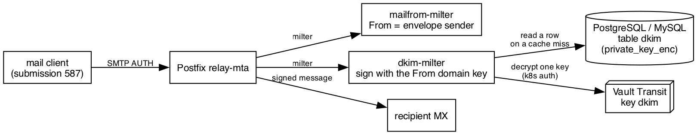

```{=latex}
\begin{center}
{\LARGE\bfseries TECHNICAL DOCUMENTATION}\\[16pt]
{\large\bfseries Service: dkim-milter}
\end{center}
\vspace{10pt}
```

## dkim-milter

Postfix milter in Go that DKIM-signs each message with the key of its `From:` domain. Keys per domain come from the table `dkim` in PostgreSQL or MySQL, private keys encrypted with Vault Transit; each is decrypted on the domain's first message into a bounded cache, so a sealed Vault stops only domains not in the cache, whose mail waits in the queue. A message it cannot sign is accepted unsigned; the milter never holds mail.

{ width=100% }

**Stack**

- Go 1.27 (`alpine:3.24` runtime image)
- `github.com/0kaba0hub/go-milter` v0.5.0 (milter protocol)
- `github.com/emersion/go-msgauth` v0.7.0 (DKIM, RSA and Ed25519)
- `github.com/jackc/pgx/v5`, `github.com/go-sql-driver/mysql` (key table)
- Vault Transit over HTTP, Kubernetes auth
- `log/slog` JSON logs, Prometheus metrics

**Directory layout**

```
dkim-milter/
|- app/go/          main.go config.go keys.go vault.go signer.go metrics.go, tests, Dockerfile
|- helm/            chart: Deployment, Service, ServiceAccount, NetworkPolicy, Vault CA Certificate
|- helm_values/     values-sandbox.yaml (MySQL, Vault), values-keptemail.yaml (PostgreSQL, Vault), *-fwd.yaml (second release, SIGN_AUTH any)
|- schema/          postgres.sql, mysql.sql
`- doc/             this document, architecture diagram
```

**Components**

| Part | What |
|:---|:---|
| milter session | signs only for a SASL-authenticated client: one of the From domain (`SIGN_AUTH=aligned`) or any (`any`); collects headers and body, signs at end of message, inserts `DKIM-Signature` at the top |
| key cache | loads a domain's newest row on its first message, LRU of `KEY_CACHE_SIZE`; past the TTL the key signs on while the row is read again in the background; tempfail only for an uncached domain while the database or Vault is down |
| Vault client | Kubernetes login with the ServiceAccount token, kept until four fifths of its TTL; one decrypt per load |
| metrics | `/healthz`, `/readyz` (the key query runs and the token may decrypt), `/metrics` |

## Environment variables

| Variable | Default | What |
|:---|:---|:---|
| `LISTEN_ADDR` / `METRICS_ADDR` | `0.0.0.0:8891` / `0.0.0.0:8081` | listeners |
| `DB_DRIVER` / `DB_DSN` / `DB_MAX_OPEN_CONNS` | `postgres` / --- / `10` | database |
| `DKIM_SQL_QUERY` | `SELECT domain, selector, private_key_enc FROM dkim WHERE lower(trim(domain)) = $1 ORDER BY created_at DESC, id DESC LIMIT 1` (`?` for mysql) | one domain's newest row |
| `MILTER_READ_TIMEOUT_SECONDS` / `MILTER_WRITE_TIMEOUT_SECONDS` | `3600` / `60` | milter connection timeouts |
| `KEY_DECRYPT` | `vault` | `vault` or `none` |
| `SIGN_AUTH` | `aligned` | `aligned` or `any`; no login, no signature |
| `KEY_CACHE_SIZE` / `KEY_CACHE_TTL_SECONDS` / `KEY_CACHE_MISS_TTL_SECONDS` | `10000` / `600` / `60` | key cache |
| `VAULT_ADDR` / `VAULT_ROLE` | --- | required with `vault` |
| `VAULT_AUTH_PATH` / `VAULT_TRANSIT_PATH` / `VAULT_TRANSIT_KEY` | `kubernetes` / `transit` / `dkim` | mounts and key |
| `VAULT_SA_TOKEN_FILE` / `VAULT_CACERT` | SA token path / --- | login token, CA |
| `LOG_LEVEL` | --- | `debug` |

## Deploy

The stand installs the chart with `helm upgrade` in `yarilo-relay`, beside yarilo-postfix; keptemail's ArgoCD application lives in `k8s_keptemail` with the cluster's other applications. The DSN comes from a Secret (`db.dsnSecret`); with `keyDecrypt: vault` the chart mounts the ServiceAccount token for the Vault role. Postfix: `smtpd_milters` after `mailfrom-milter`, `non_smtpd_milters`, `milter_default_action = tempfail`. With `networkPolicy.enabled` only the Postfix pods reach the milter port, on a CNI that enforces NetworkPolicy.

## Logging

JSON on stdout, one line per message: `dkim: signed` with domain, selector and queue id, `dkim: not signed` with the reason (no From domain, a client that may not sign for it, no key, a key that would not sign), or `dkim: tempfail` when no key is cached and none can be read. Key loads, selector changes, refresh failures, tempfails, Vault failures and unusable keys are logged with the domain they concern.
